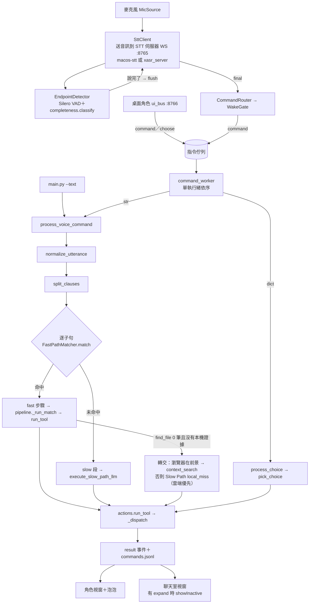
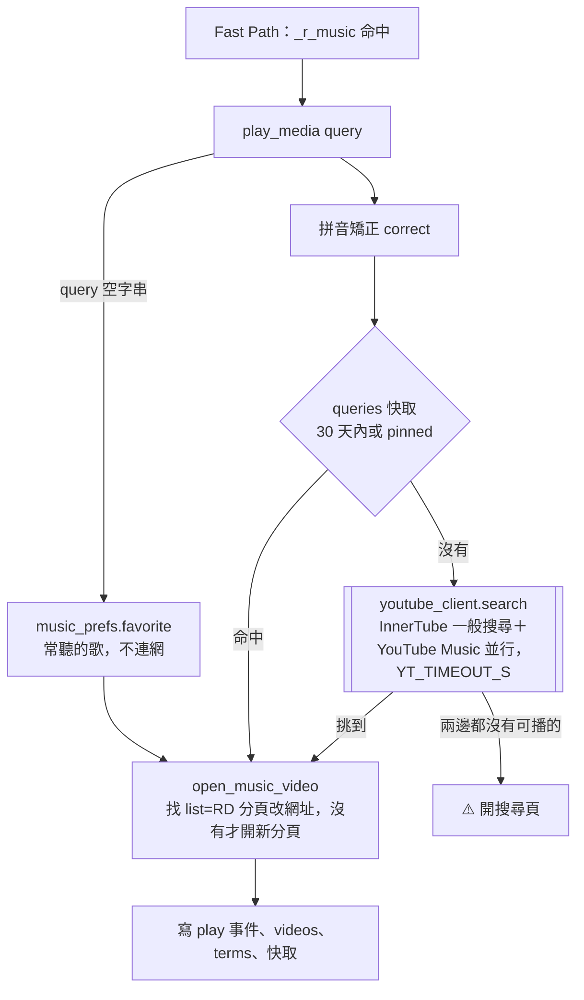
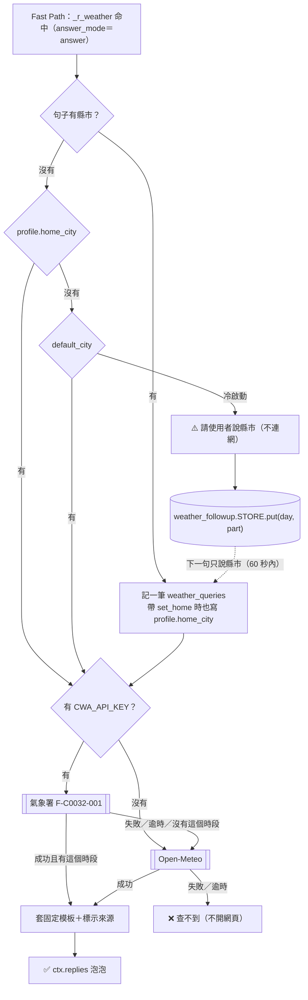
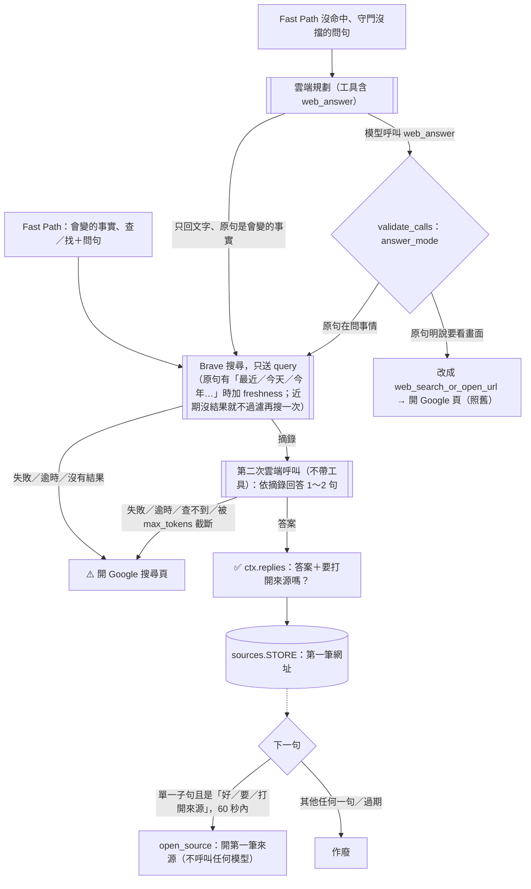
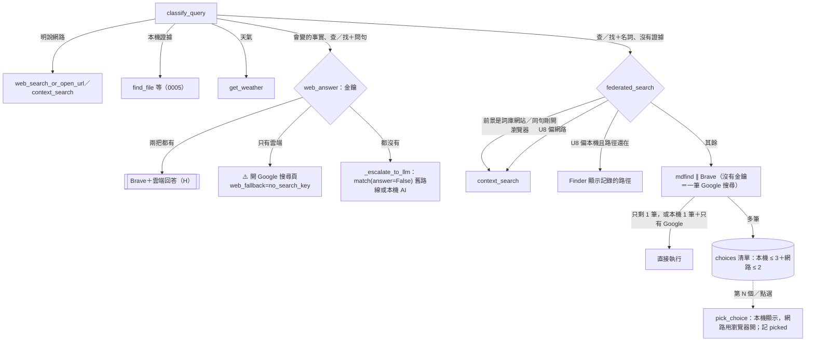

# 主流程：輸入 → 路由 → 執行 → 回報

從三種輸入到執行結果回到桌面角色。Slow Path（LLM 規劃）的細節見 [slow-path.md](slow-path.md)；模組依賴見 [module-deps.md](module-deps.md)；圖的寫法見 [README.md](README.md)。

## A. 輸入來源

階段：STT 執行緒（麥克風）與 `ui-bus` 執行緒（桌面角色）只收輸入、放進佇列；`--text` 在主執行緒直接執行。

三種輸入，最後都匯進同一個佇列（`--text` 除外）。

- **麥克風** `stt/mic.MicSource`（PCM）
  - `stt/client.SttClient` 把音訊送到 STT 伺服器（WS :8765），同時逐窗跑 Silero VAD，交給 `endpoint.EndpointDetector`。伺服器是 macos-stt 或 `stt/xasr_server`（`main.py --stt-engine`、預設 `config.STT_ENGINE`；macOS 預設 macos-stt，Windows 預設 xasr），兩者說同一套 WS 協定，client 與之後的流程不分引擎（[0020](../decisions/0020-stt-engine-xasr.md)）。
  - `EndpointDetector` 是純邏輯，時間由外部注入。它結合 VAD 的 onset／offset 遲滯，以及 partial 文字經 `completeness.classify` 的結果：
    - `classify`：去喚醒詞 → normalize → split_clauses → 每個子句都被 `FastPathMatcher.match` 命中，就算 complete。
    - 收句門檻：complete 靜音 0.35 s；incomplete（句尾接續詞、光動詞）多等；其餘用 default。另有 `asr_stall`、`max_len` 保底。
    - 決定「說完了」時，先送剩下的音訊，再送 `{"type":"flush"}`。一直沒有文字的語音段當噪音放棄。
  - server 事件：partial 只更新偵測器；final 會編上 `utt_id`，計時寫進 `logs/runtime/latency.jsonl`。
  - `assistant.CommandRouter`（STT 執行緒）：
    - partial → 終端顯示；`--ui` 時 publish `{"partial", wake}`。
    - utterance／final → paused 時丟棄，否則交給 `WakeGate.feed`（加鎖）：
      - command（去掉句首喚醒詞，或在會話內）→ `SpokenCommand(utt_id, enqueued_at)` 放進佇列。
      - armed（只說喚醒詞）→ 開 60 s 會話；ignored → 不執行。
- **桌面角色**（`--ui`）：`ui_bus`（127.0.0.1:8766、需要 token、不收帶 Origin 的連線）→ `parse_ui_message` 驗證 → `CommandRouter.on_ui_message`。
  - command → 佇列（不經 WakeGate、不續會話）；choose → 佇列（dict）；wake／pause／quit 只改狀態。
- **CLI**：`main.py --text` 直接呼叫 `process_voice_command`，不起服務、不經佇列與喚醒詞。

## B. command_worker

階段：執行階段（`command_worker` 執行緒）。

單執行緒、依序執行；單一指令出例外只記錯，不停下。

- `QueuedJob`（內部工作，例如點歌定時整理）→ 直接 `run()`；不發 executing／result 事件、不寫 `commands.jsonl`，出錯只印錯誤
- str → `pipeline.process_voice_command`
- dict → `pipeline.process_choice` → `run_tool("pick_choice")`（和語音說「第 N 個」走同一個工具）
- 輸出：
  - `result_event`：steps 帶 route／ms；有 expand 才帶這個欄位（見 C.6）→ publish 給 UI。
  - `command_record`：家目錄換成 `~`、不含 choices → `logs/runtime/commands.jsonl`（帶 `utt_id`、`queue_ms`、`expand`）。

## C. process_voice_command

階段：`command_worker` 執行緒；步驟 3 的 `match()` 是比對階段（純函式），其餘是執行階段。

0. `catalog.DEFAULT.refresh_if_stale()`：已安裝 App 清單超過 60 s 才重掃，在指令執行緒上做。
1. `normalize_utterance`：NFKC＋空白 → 簡轉繁（詞庫 s2t）→ 誤聽詞（記下 misheard，供還原原話）→ 中文數字（只在數值語境）→ 疊詞。接著 `log_normalization`，只記詞庫造成的改動。
2. `split_clauses`：依標點與「然後／接著／再幫我／順便／還有／並且／以及」切，不以空白切。
3. 逐子句跑 `FastPathMatcher.match`。這是純比對：不執行、不讀前景、不碰網路或 LLM。順序：
   - 「讓電腦睡眠」固定句 → `canonicalize_clause`（去填充詞、「把 X 打開」改成「打開 X」）
   - → `_r_negated_command`（窄的否定即指令；含「不要再放這首」）→ `_blocked`（否定／敘述，`_narrative_exempt` 例外）→ None
   - → `_read_screen_re` →「我最常聽什麼」（含「什麼」，所以在問句守門之前，只收這幾句）→ `classify_query(stage="lead")`（「我住 X」、天氣、會變的事實、查／搜尋＋問句或名詞、明說網路；只豁免問句這一關，要在 `_blocked` 之後；[0021](../decisions/0021-weather-answer.md)、[0023](../decisions/0023-query-routing.md)、[0024](../decisions/0024-home-city-and-answer-timeout.md)，見 G、I）→ `_route_query` → `_QUESTION_RE` → None
   - → `_r_front`（「播放」「暫停」「下一首」這類整句說法先比對）→ `_r_music_feedback`（換一首、我喜歡這首）→ `_r_music`（點歌，比對**原句**，不是 canonicalize 後的）→ `_r_tab` → `_r_project` → `_r_volume` → `_r_mute` → `_r_brightness` → `_r_dark` → `_r_lock`
   - → `_r_find`（`classify_query(stage="find")`）→ `_r_pick` → `_r_site` → `_r_app` → `_r_front_degree`（第一個命中的規則勝出）
   - 例外：天氣冷啟動的待答在每句開頭 `weather_followup.STORE.take()` 取走。這句只有一個子句、而且 `parse_city_reply` 認得是縣市回答 → 不跑 `match()`，直接 `get_weather`（見 G）。
   - 命中 → `("fast", [子句], Match)`，各自成一步；未命中 → 併進前一個 slow 段（連續的才合併），否則新開 slow 段。
4. 建立 `ExecContext`（整句共用、不跨語句），依說話順序跑每一段：
   - **fast** → `pipeline._run_match` → `run_tool`（逐個動作）
     - `find_file` 0 筆且不是 `local_only` → `ctx.escalate` → `_escalate_to_llm`（查詢用原話＋`restore_misheard`）
       - 前景是瀏覽器 → `context_search`（不問模型）
       - 否則 → `execute_slow_path_llm(local_miss=…)`（有雲端金鑰走雲端規劃，否則本機 LLM）；LLMError → `local_miss_reply`
     - `remember_home`（「我住 X」，已在背景記下居住地）→ `ctx.escalate`（kind chat）→ `execute_chat_only`：同一步只聊天，模型提出的工具一律不執行（見 G）
     - `web_answer` 兩把金鑰都沒有 → `ctx.escalate`（kind slow）→ `_escalate_to_llm` 用 `match(answer=False)` 重比：命中就走舊路線（開網頁、找檔案），沒命中交給本機 Slow Path
   - **slow** → `execute_slow_path_llm`（送原句，不是 canonicalize 後的）
     - LLMError → `_recover_slow_segment`：`match(candidates=True)` 有候選才執行，否則回「AI 無法使用」
   - `step["status"] = _step_status`：`ctx.status` 優先，再看結果字串前綴（❌⚠️ → exec_failed、⏭️ → skipped）。
   - fast 步驟成功、沒有轉交、而且有分類結果 → `record_explicit_search`（明說範圍的找／搜尋記一筆統計，見 I）。
5. `memory.STORE.add`（原句、工具與成敗、回覆）→ 回傳 `{stages, steps, replies, total_ms}`，有 expand 才帶。
6. `expand_reason`（聊天室主動展開，只看這一句的 ctx）：`read_screen` 成功 → screen；`ctx.ai_reply`（本機 chat call 或被採用的雲端文字）→ chat；動作數（`ctx.calls` 不含 `chat_reply`）≥ `EXPAND_MIN_ACTIONS`，或回覆總字數 > `EXPAND_REPLY_CHARS` → complex；都不是就沒有 expand。

## E. 執行

階段：執行階段（`command_worker` 執行緒）；結果顯示在桌面行程（Electron）。

`actions.run_tool` → `_dispatch`（記 `exec_ms`、`ctx.results`、`ctx.calls`）

- `control_mac_app` 開瀏覽器或編輯器 → 記下 `last_browser`／`last_editor`，成功時重置前景快取；失敗 → `ctx.failed`。
- `web_search`／`browser_tab`／`open_project`／`read_screen`：前置失敗就 ⏭️ 略過；對象依序是明說 → 同句剛開 → 前景 → 預設。
- `LOCAL_TOOLS`（`open_folder`、`find_file`、`federated_search`、`pick_choice`、`context_search`、`front_action`、`play_media`、`music_replace`、`music_feedback`、`music_top`、`get_weather`、`remember_home`）→ 依功能在 `find_tools`、`front_tools`、`music_tools`、`answer_tools`（由 `local_actions` 登錄）。
- `front_action` → `native.py`（視窗、選單、按鈕、App 指令；最後才送按鍵，送前重讀前景 pid）。
- `read_screen` → `screencapture`；雲端路線且 `CLOUD_VISION_ENABLED` 時，看圖走雲端。

結果 → result 事件 →（`--ui`）`ui_bus` WebSocket :8766 → `desktop/main/`（`bus.js` 是唯一持有連線與 token 的地方）：

- 角色視窗：Electron＋Live2D＋泡泡；有 expand 時，泡泡只顯示「詳細內容在對話視窗」。
- `chat.js`：紀錄只放記憶體，重開清空 → 聊天室視窗。這是獨立視窗，平常隱藏；隱藏時不推紀錄，展開前才補送。有 expand 時 `showInactive` 展開，無互動 20 秒收回。

## F. 點歌與播放控制

階段：執行階段（`command_worker` 執行緒）；比對（`match()`）只看句子。決策見 [0019](../decisions/0019-music-play.md)。

**點歌 `play_media(query)`**

1. 資料庫還沒準備好（`MUSIC_DB.conn()` 是 None）：跳過矯正、快取與寫入，照常搜尋播放。
2. 矯正（`music_prefs.correct`，每次改寫寫一筆 `correct` 事件）→ 快取。`query` 空字串＝常聽的歌，沒有紀錄回 ⚠️。
3. 沒命中快取：InnerTube 兩邊並行、共用同一個截止時間；YouTube Music 第一筆通過接受規則才採用，再挑官方 MV（`source`＝mv／ytm）；只說歌手（YouTube Music 回歌手卡片）播卡片第一首（ytm）；否則播一般搜尋第一筆（web）。InnerTube 沒有可播的結果就開搜尋頁（page，回 ⚠️，另寫 `fallback` 事件，失敗分類在 `source` 欄位）。InnerTube 回 4xx 只標記 `clientVersion` 需要更新。
4. 開啟成功後寫 `play` 事件，更新 `videos`、`terms`、快取。結果字串前綴照紅線 11（✅ 播放、⚠️ 退回搜尋頁、❌ 開啟失敗）。

**播放控制（`front_action`：play_pause、next_track、prev_track）**

- 前景是 Music／Spotify／YouTube 分頁：照 `app_shortcuts` 的綁定（Music／Spotify 用 App 指令，YouTube 按播放器按鈕）。「暫停」「繼續」帶方向（已是目標狀態回 ✅ 不動作），單說「播放」「播放暫停」是切換。
- 其他前景 → `_background_control`，依序嘗試，前一個成功就停：
  1. Safari 最近使用的視窗目前顯示的是 YouTube 影片分頁 → 輔助使用 API 按該視窗的播放器按鈕（`source=ax`）
  2. Safari 任何視窗任何分頁是 YouTube 影片 → 送媒體鍵（`source=mediakey`，只有 play／next／previous）
  3. 都不成立 → ⚠️「找不到正在播放的音樂」
- 成功後 `_record_control` 寫 next／prev／pause／resume 事件（toggle 與「已經是這個狀態」不寫）；播放後 30 秒內的 next 會讓該影片扣 0.3 分。

**回饋**：換一首（`music_replace`）改播同一次搜尋的下一個候選並釘選；喜歡／不要再放（`music_feedback`）讀 Safari 音樂分頁目前的 videoId；我最常聽什麼（`music_top`）把前 5 名放進 `ctx.replies`。這幾個都不連網、不呼叫 LLM。

**定時整理**：`MusicMaintenance` 的計時器執行緒（`MAINT_POLL_S` 檢查一次）到期（啟動時一次、之後每 `MUSIC_MAINT_INTERVAL_S`）就把 `QueuedJob` 排進指令佇列，由 `command_worker` 做 `terms` 衰減與刪除；做完另開短命執行緒抓兩個首頁的 `clientVersion`（只做網路），結果再排回佇列寫入 `maintenance` 表。寫資料庫的永遠只有 `command_worker`。

## G. 天氣

階段：執行階段（`command_worker` 執行緒）；比對（`match()`）只看句子，產生 `get_weather(city, day, part)`（「我住 X＋天氣」另帶 `set_home`）或 `remember_home(city)`。決策見 [0021](../decisions/0021-weather-answer.md)、[0024](../decisions/0024-home-city-and-answer-timeout.md)。

- 預設縣市：居住地 `profile.home_city` → 最近 90 天明說次數最多（同票取最近）→ 全部歷史 → 冷啟動。用預設補上的縣市不記。`step["weather"]` 記 `default`（`home`／`stats`）。
- 居住地只記使用者明說的（`source`：`said`＝我住 X、`cold_start_reply`＝冷啟動後回答的縣市），再說一次就覆寫；只在本機，不送雲端、不進對話記憶。
- 冷啟動接續：待答在每句開頭取走，下一句不是縣市回答（或有兩個以上子句、超過 60 秒）就作廢。
- 「我住 X」（`remember_home`）：寫居住地與統計，結果行只進 log；接著 `execute_chat_only` 只聊天。有雲端走雲端規劃，user 訊息最後附 `<note>`，丟棄所有工具呼叫（`step["chat_dropped"]`）；沒有雲端或熔斷走本機 `chat_reply`（`chat_hint`＝note，不帶工具）；模型沒給文字回固定句。資料庫還沒準備好：回 ⚠️，不說已記住。
- 氣象署的 36 小時資料在凌晨問明天、中午問明晚時沒有那個時段，視同失敗改查 Open-Meteo。
- 錯誤只留分類（timeout、network、http_NNN、bad_json、bad_format、no_data），不含金鑰、網址與回應內容；每個來源各自逾時 `WEATHER_TIMEOUT_S`。
- 資料庫還沒準備好：明說縣市照常回答、不記；沒說縣市當冷啟動。

## H. 長尾回答與來源追問

階段：入口由比對階段（純函式）或雲端規劃決定；搜尋、回答與來源追問是執行階段（`command_worker` 執行緒）。決策見 [0022](../decisions/0022-web-answer.md)、[0023](../decisions/0023-query-routing.md)。

兩條入口：會變的事實與查／找＋問句由 Fast Path 直接產生 `web_answer`（不經規劃）；其他問句在雲端規劃時由模型選。`match()` 不看金鑰，缺金鑰怎麼退回由 `web_answer` 執行時決定（見 I）。

- 待決來源在每句開頭 `sources.STORE.take()`（取走就清掉），所以下一句不是肯定回答就作廢；沒有待決時，「好」照平常的路由走。
- 摘錄只在這次呼叫的記憶體裡：不寫 log、不進資料庫與對話記憶；送雲端的只有標題、摘要與網頁日期（`date` 屬性，Brave 的 `page_age`；XML 跳脫、不含網址）。回答那次推理照雲端設定（`low`），`max_tokens`＝`WEB_ANSWER_MAX_TOKENS`（4096），逾時 `WEB_ANSWER_TIMEOUT_S`（10 秒）。這次逾時不熔斷（`trip_on_timeout=False`，meta `breaker`＝`skipped`），下一句照常走雲端；連線失敗、429、5xx 照舊熔斷（[0024](../decisions/0024-home-city-and-answer-timeout.md)）。
- 延遲與錯誤分類記在 `step["web"]`（`search_ms`、`results`、`freshness`、`fresh_retry`、`answer_ms`、`cloud`（含 `finish_reason`）、`error`），寫進 `commands.jsonl`。

## I. 查詢路由與聯合搜尋

階段：分類 `query_intent.classify_query` 是比對階段（純函式），Fast Path 用它決定路線；聯合搜尋與統計是執行階段（`command_worker` 執行緒）。決策見 [0023](../decisions/0023-query-routing.md)。

- **統計** `search_terms`（`data/music.sqlite3`）：只記 picked（從清單選的那一邊，本機連同路徑）與 explicit（Fast Path 成功、明說範圍）。網路不記網址。`lean` 要同一個詞 90 天內同一邊 ≥ 2 次、另一邊 0 次才直接執行，沒達門檻的只決定清單順序。資料庫還沒準備好時當成沒有歷史。
- **不寫進紀錄的**：Brave 的標題與網址只在記憶體的清單裡（60 秒）。log 的清單行只寫「（網路）」，`commands.jsonl` 不寫 `choices`，`step["federated"]` 只記筆數、毫秒、lean、錯誤分類。

## J. 量測鏈

階段：STT 執行緒編號、`command_worker` 執行緒寫入。

語音指令的 latency 與 commands 紀錄以 `utt_id` 對應：`SttClient` 編號 → `SpokenCommand` 帶進佇列 → `command_worker` 寫入。改這條鏈時要保持。
