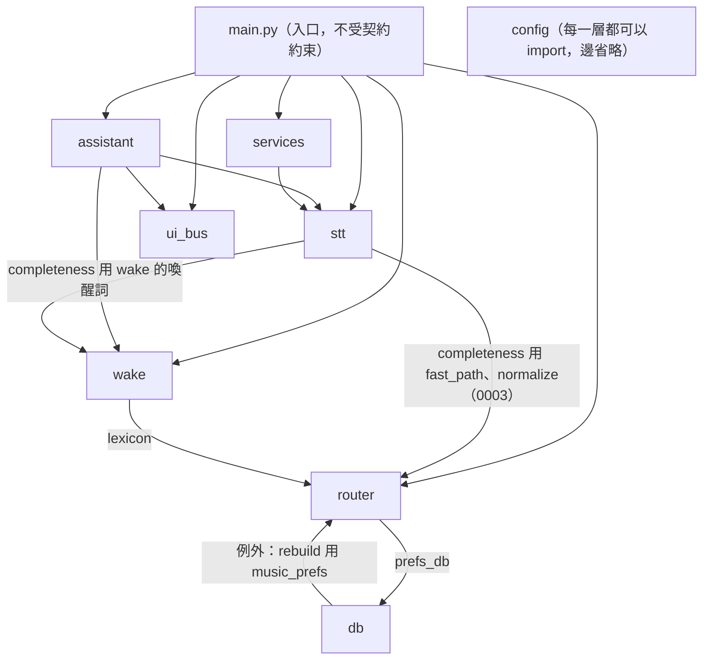
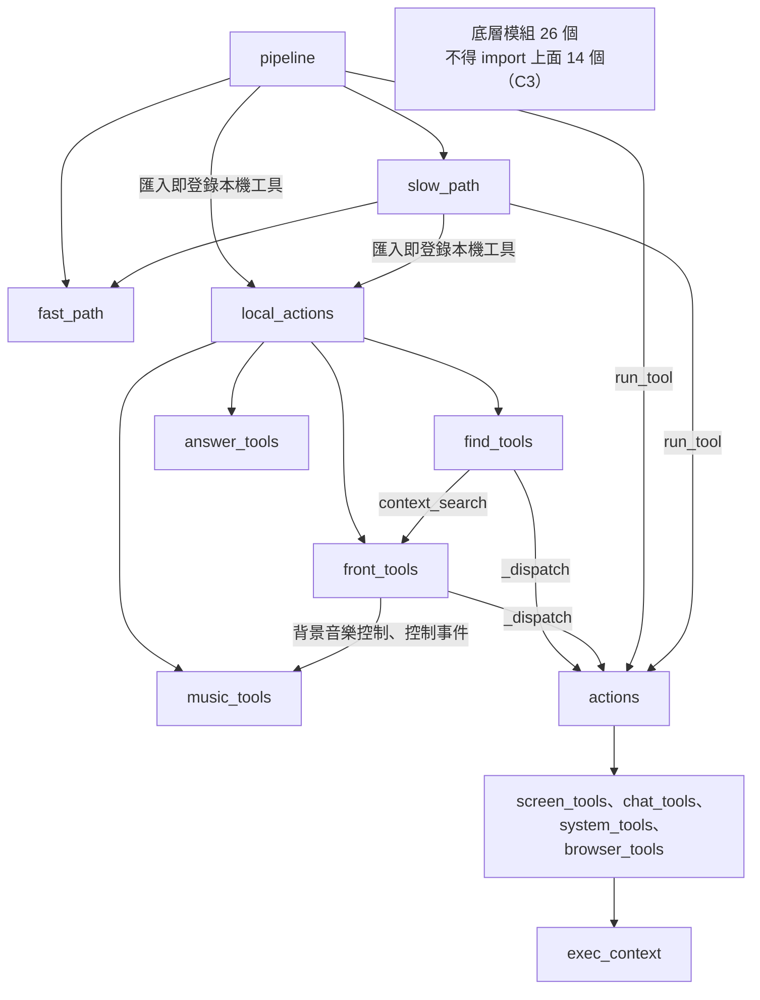

# 模組依賴：`mac_ai/` 的分層、編排流向與已知例外

這份是**結構檔**：只記錄 Python 端「誰可以 import 誰」的現況、例外與結構債；規則本身以 repo 根目錄的 `.importlinter` 為準（`uvx --from import-linter==2.16 --with grimp==3.19 lint-imports`，在 repo 根目錄執行）。執行時的流程見 [main-flow.md](main-flow.md)、[slow-path.md](slow-path.md)；模組職責見 [ARCHITECTURE.md](../../ARCHITECTURE.md)；契約的決策見 [0026](../decisions/0026-import-linter.md)，靜態檢查分工見 [0025](../decisions/0025-static-checks.md)。桌面端（`desktop/`）的分層另由 `layers.test.js` 檢查，不在這裡。

- 本文件的圖裡，箭頭 `A --> B` 表示 **A import B**（包含函式內的 import），邊上的文字是說明。
- 範圍只有 `mac_ai` 套件。`main.py`、`scripts/`、`bench/`、`tests/` 不受契約約束。
- 幾乎每個模組都會 import `config`，圖中省略這些邊。

## 套件分層（C1）

依賴只能往下；同一列用 `｜` 分隔的彼此互不依賴：`assistant｜services` > `stt｜ui_bus` > `wake` > `router` > `db` > `config`。

| 層 | 模組 | 直接 import（`mac_ai` 內部，不含 `config`） |
|---|---|---|
| 1 | `assistant` | `stt.client`、`stt.completeness`、`stt.endpoint`、`stt.latency_log`、`stt.vad`、`ui_bus`、`wake` |
| 1 | `services` | `stt.latency_log`、`stt.xasr_server` |
| 2 | `stt.client` | `stt.endpoint`、`stt.vad` |
| 2 | `stt.completeness` | `router.fast_path`、`router.normalize`、`wake` |
| 2 | `stt.endpoint` | `stt.completeness`、`stt.vad` |
| 2 | `stt.xasr_server` | `stt.xasr_hotwords` |
| 2 | `stt.mic`、`stt.vad`、`stt.latency_log`、`stt.xasr_hotwords`、`ui_bus` | — |
| 3 | `wake` | `router.lexicon` |
| 4 | `router.*` | 見下一節 |
| 5 | `db` | — |
| 5 | `db.rebuild` | `db`、`router.music_prefs`（例外） |
| 6 | `config` | — |

## router 編排流向（C2、C3）

主流程的方向（C2，只能往下；同一列用 `｜` 分隔的彼此互不 import）：

`pipeline` > `slow_path` > `fast_path` > `local_actions` > `find_tools` > `front_tools` > `music_tools`｜`answer_tools` > `actions` > `screen_tools`｜`chat_tools`｜`system_tools` > `browser_tools` > `exec_context`

- `fast_path` 只比對、不執行：回傳的 `Match` 只有資料，由 `pipeline` 呼叫工具。
- `local_actions` 只做本機工具的登錄（載入時把 4 個功能模組的工具放進 `actions.LOCAL_TOOLS`）。
- `*_tools` 依功能分（[0030](../decisions/0030-router-feature-modules.md)）；`actions` 只做分派（`AVAILABLE_FUNCTIONS`、`_dispatch`、`run_tool`），`exec_context` 是所有工具共用的 `ExecContext` 與前景讀取。
- 其餘 26 個 router 模組是底層，不得 import（含間接）上面這 14 個（C3）。

圖只畫主要的邊；`slow_path` 直接用 `answer_tools.today_taipei`、`chat_tools.chat_reply`，`pipeline` 直接用 `find_tools.record_explicit_search`，各模組都用 `exec_context`，完整的依賴見下表。上面每個模組都可以 import 底層模組。

`router/__init__.py` 對外提供 `pipeline`、`slow_path`、`fast_path`、`exec_context`、`system_tools`、`browser_tools`、`screen_tools` 等模組的名稱給 `main.py` 與測試使用，**用到才 import**（PEP 562 的 `__getattr__`），不屬於任何一層。載入任何 router 子模組前 Python 都會先執行它，所以不能在裡面頂層 import 子模組；import-linter 看不到這條路，由 `tests/runtime/test_import_footprint.py` 守住。

| 類別 | 模組 | 直接 import（`mac_ai` 內部，不含 `config`） |
|---|---|---|
| 編排 | `router.pipeline` | `actions`、`catalog`、`exec_context`、`fast_path`、`find_tools`、`llm_client`、`local_actions`、`memory`、`normalize`、`query_intent`、`slow_path`、`sources`、`weather_followup` |
| 編排 | `router.slow_path` | `actions`、`answer_tools`、`chat_tools`、`cloud_client`、`context`、`exec_context`、`fast_path`、`lexicon`、`llm_client`、`local_actions`、`memory`、`query_intent`、`search_client`、`tools` |
| 編排 | `router.fast_path` | `action_plan`、`catalog`、`context`、`domain`、`lexicon`、`query_intent` |
| 本機工具登錄 | `router.local_actions` | `actions`、`answer_tools`、`find_tools`、`front_tools`、`music_tools` |
| 本機工具 | `router.find_tools` | `actions`、`browser_tools`、`choices`、`exec_context`、`front_tools`、`lexicon`、`prefs_db`、`proc`、`search_client`、`search_prefs` |
| 本機工具 | `router.front_tools` | `actions`、`context`、`exec_context`、`music_tools`、`native`、`proc` |
| 本機工具 | `router.music_tools` | `browser_tools`、`context`、`exec_context`、`music_prefs`、`native`、`prefs_db`、`proc`、`youtube_client` |
| 本機工具 | `router.answer_tools` | `browser_tools`、`cloud_client`、`exec_context`、`prefs_db`、`profile_store`、`search_client`、`sources`、`weather_client`、`weather_followup`、`weather_prefs` |
| 分派 | `router.actions` | `browser_tools`、`chat_tools`、`exec_context`、`lexicon`、`screen_tools`、`system_tools` |
| LLM 看得到的工具 | `router.screen_tools` | `browser_tools`、`cloud_client`、`exec_context`、`llm_client`、`normalize`、`proc` |
| LLM 看得到的工具 | `router.chat_tools` | `exec_context`、`llm_client`、`normalize` |
| LLM 看得到的工具 | `router.system_tools` | `exec_context`、`lexicon`、`proc` |
| LLM 看得到的工具 | `router.browser_tools` | `exec_context`、`proc` |
| 執行基礎 | `router.exec_context` | `context`、`proc` |
| 純比對 | `router.lexicon` | — |
| 純比對 | `router.normalize`、`router.domain` | `lexicon` |
| 純比對 | `router.query_intent` | `domain`、`lexicon` |
| 純比對 | `router.action_plan` | `domain` |
| 前景與原生 | `router.context` | `lexicon` |
| 前景與原生 | `router.native` | — |
| 外部指令 | `router.proc` | — |
| 工具定義與 App 清單 | `router.tools` | `catalog`、`lexicon` |
| 工具定義與 App 清單 | `router.catalog` | `lexicon`、`proc` |
| 網路 client | `router.llm_client` | `tools` |
| 網路 client | `router.cloud_client` | `context`、`hant`、`normalize`、`tools` |
| 網路 client | `router.youtube_client` | `pinyin` |
| 網路 client | `router.weather_client` | `lexicon` |
| 網路 client | `router.search_client` | — |
| 狀態與偏好 | `router.prefs_db` | `db` |
| 狀態與偏好 | `router.memory` | `tools` |
| 狀態與偏好 | `router.search_prefs` | `lexicon` |
| 狀態與偏好 | `router.music_prefs` | `pinyin` |
| 狀態與偏好 | `router.weather_prefs`、`router.profile_store`、`router.choices`、`router.sources`、`router.weather_followup` | — |
| 文字工具 | `router.hant`、`router.pinyin` | — |

熱路徑（C4）是 `fast_path`、`action_plan`、`query_intent`、`domain`、`normalize`、`lexicon`、`stt.completeness`、`stt.endpoint`、`wake`：不得 import（含間接）5 個網路 client、`native`、`db`、`subprocess`、`sqlite3`、`socket`、`http`。唯一的例外是 `catalog` 經 `proc` 跑 `mdfind`（見下方例外表）。網路 client（C5）不得 import `db`、`sqlite3`、`subprocess`。`urllib` 無法用 import-linter 區分 `parse` 與 `request`，網路呼叫的範圍由 ast-grep 的 `urlopen-only-in-clients` 檢查。

## 循環

沒有循環（2026-11-26 依賴收斂：`_run` 移到底層的 `proc`，`catalog` 不再需要在函式內 import `actions`）。

## 例外（`.importlinter` 的 `ignore_imports`）

這張表要和 `.importlinter` 所有契約的 `ignore_imports` 完全一致。新增或刪除例外要先問使用者；依賴消失後一定要刪掉例外，否則 `lint-imports` 會報 `No matches for ignored import`。

| 依賴 | 契約 | 原因 | 何時刪除 |
|---|---|---|---|
| `mac_ai.db.rebuild -> mac_ai.router.music_prefs` | C1 | 重算 `terms` 的維護 CLI（`python -m mac_ai.db.rebuild`）重用 `music_prefs` 的計分邏輯 | 計分邏輯不在 `router` 時 |
| `mac_ai.router.catalog -> mac_ai.router.proc` | C4、C5 | `_scan_installed` 用 `proc._run` 跑 `mdfind`；只在快取是空的或過期時執行（`main.py` 啟動時先掃） | 掃描函式改由組裝處注入 `catalog` 時 |

## 結構債（記錄現況，不在任何計畫內處理）

- **`LOCAL_TOOLS` 靠 import 副作用登錄**：`local_actions` 載入時登錄，會呼叫 `run_tool` 的 `pipeline`、`slow_path` 都在頂層 import 它（`tests/runtime/test_import_footprint.py` 檢查）。
- **跨模組用私有名稱**：`find_tools`、`front_tools` 用 `actions._dispatch`（沿用「瀏覽器失敗就略過」與 `mark_page`），`front_tools` 用 `music_tools` 的 `_background_control`、`_control_op`、`_record_control`，各模組用 `prefs_db._now`、`_rng`、`_db_call`。搬移時沒有改名（[0030](../decisions/0030-router-feature-modules.md)）。
