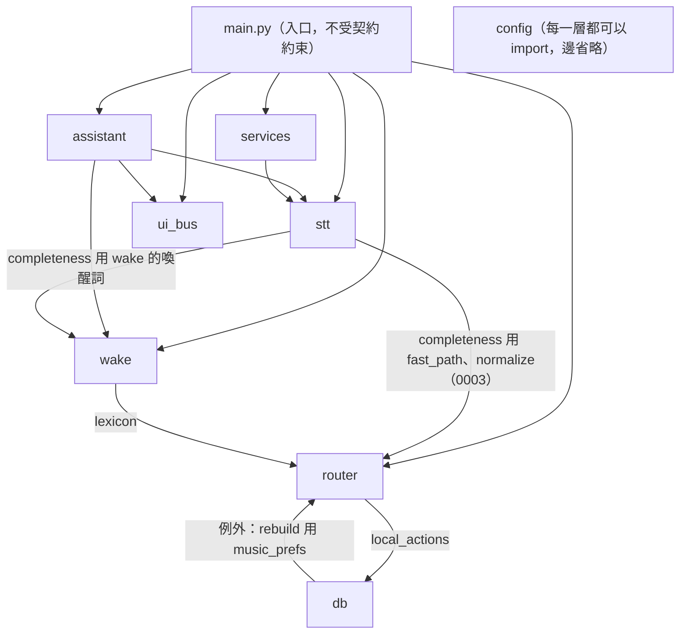
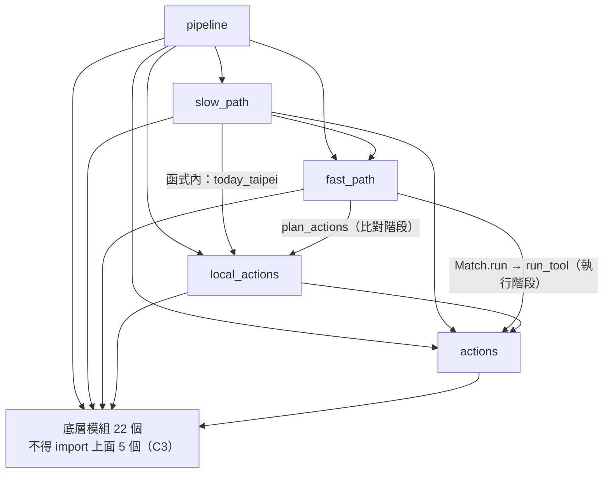
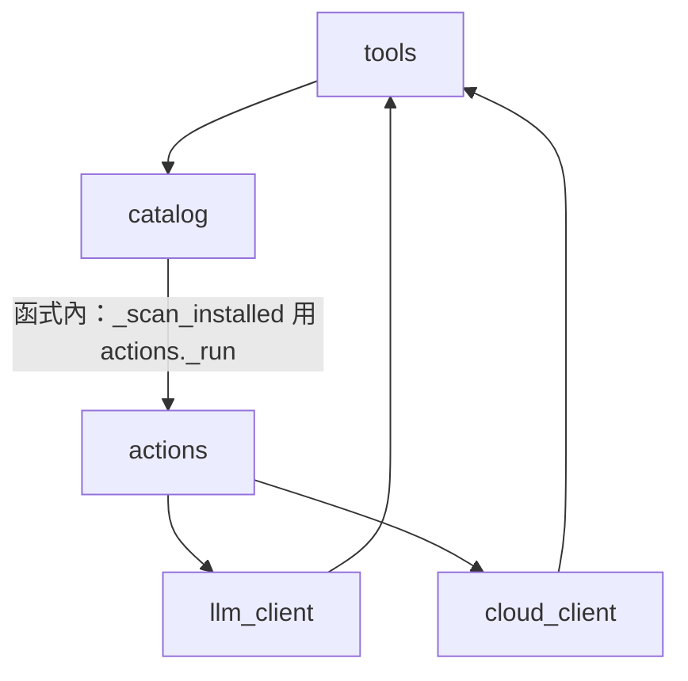

# 模組依賴：`mac_ai/` 的分層、編排流向與已知例外

這份是**結構檔**：只記錄 Python 端「誰可以 import 誰」的現況、例外與結構債；規則本身以 repo 根目錄的 `.importlinter` 為準（`uvx --from import-linter==2.16 --with grimp==3.19 lint-imports`，在 repo 根目錄執行）。執行時的流程見 [main-flow.md](main-flow.md)、[slow-path.md](slow-path.md)；模組職責見 [ARCHITECTURE.md](../../ARCHITECTURE.md)；契約的決策見 [0026](../decisions/0026-import-linter.md)，靜態檢查分工見 [0025](../decisions/0025-static-checks.md)。桌面端（`desktop/`）的分層另由 `layers.test.js` 檢查，不在這裡。

- 本文件的圖裡，箭頭 `A --> B` 表示 **A import B**（包含函式內的 import），邊上的文字是說明。
- 範圍只有 `mac_ai` 套件。`main.py`、`scripts/`、`bench/`、`tests/` 不受契約約束。
- 幾乎每個模組都會 import `config`，圖中省略這些邊。

## 套件分層（C1）

依賴只能往下；同一列用 `｜` 分隔的彼此互不依賴：`assistant｜services` > `stt｜ui_bus` > `wake` > `router` > `db` > `config`。

| 層 | 模組 | 直接 import（`mac_ai` 內部，不含 `config`） |
|---|---|---|
| 1 | `assistant` | `stt.client`、`stt.completeness`、`stt.endpoint`、`stt.latency_log`、`stt.vad`、`ui_bus`、`wake` |
| 1 | `services` | `stt.latency_log`、`stt.xasr_server` |
| 2 | `stt.client` | `stt.endpoint`、`stt.vad` |
| 2 | `stt.completeness` | `router.fast_path`、`router.normalize`、`wake` |
| 2 | `stt.endpoint` | `stt.completeness`、`stt.vad` |
| 2 | `stt.xasr_server` | `stt.xasr_hotwords` |
| 2 | `stt.mic`、`stt.vad`、`stt.latency_log`、`stt.xasr_hotwords`、`ui_bus` | — |
| 3 | `wake` | `router.lexicon` |
| 4 | `router.*` | 見下一節 |
| 5 | `db` | — |
| 5 | `db.rebuild` | `db`、`router.music_prefs`（例外） |
| 6 | `config` | — |

## router 編排流向（C2、C3）

主流程的方向：`pipeline` > `slow_path` > `fast_path` > `local_actions` > `actions`（C2，只能往下）。其餘 22 個 router 模組是底層，不得 import（含間接）這 5 個（C3）。

`router/__init__.py` 重新匯出 `pipeline`、`slow_path`、`fast_path`、`actions` 等模組的名稱，給 `main.py` 等呼叫端使用，不屬於任何一層。

| 類別 | 模組 | 直接 import（`mac_ai` 內部，不含 `config`） |
|---|---|---|
| 編排 | `router.pipeline` | `actions`、`catalog`、`fast_path`、`llm_client`、`local_actions`、`memory`、`normalize`、`query_intent`、`slow_path`、`sources`、`weather_followup` |
| 編排 | `router.slow_path` | `actions`、`cloud_client`、`context`、`fast_path`、`lexicon`、`llm_client`、`local_actions`（函式內）、`memory`、`query_intent`、`search_client`、`tools` |
| 編排 | `router.fast_path` | `actions`、`catalog`、`context`、`domain`、`lexicon`、`local_actions`、`query_intent` |
| 編排 | `router.local_actions` | `db`、`actions`、`choices`、`cloud_client`、`context`、`domain`、`lexicon`、`music_prefs`、`native`、`profile_store`、`search_client`、`search_prefs`、`sources`、`weather_client`、`weather_followup`、`weather_prefs`、`youtube_client` |
| 編排 | `router.actions` | `cloud_client`、`context`、`lexicon`、`llm_client`、`normalize`、`youtube_client`（函式內） |
| 純比對 | `router.lexicon` | — |
| 純比對 | `router.normalize`、`router.domain` | `lexicon` |
| 純比對 | `router.query_intent` | `domain`、`lexicon` |
| 前景與原生 | `router.context` | `lexicon` |
| 前景與原生 | `router.native` | — |
| 工具定義與 App 清單 | `router.tools` | `catalog`、`lexicon` |
| 工具定義與 App 清單 | `router.catalog` | `lexicon`、`actions`（函式內，例外） |
| 網路 client | `router.llm_client` | `tools` |
| 網路 client | `router.cloud_client` | `context`、`hant`、`normalize`、`tools` |
| 網路 client | `router.youtube_client` | `music_prefs`（例外） |
| 網路 client | `router.weather_client` | `lexicon` |
| 網路 client | `router.search_client` | — |
| 狀態與偏好 | `router.memory` | `tools` |
| 狀態與偏好 | `router.search_prefs` | `lexicon` |
| 狀態與偏好 | `router.music_prefs`、`router.weather_prefs`、`router.profile_store`、`router.choices`、`router.sources`、`router.weather_followup` | — |
| 文字工具 | `router.hant` | — |

熱路徑（C4）是 `fast_path`、`query_intent`、`domain`、`normalize`、`lexicon`、`stt.completeness`、`stt.endpoint`、`wake`：不得 import（含間接）5 個網路 client、`native`、`db`、`subprocess`、`sqlite3`、`socket`、`http`。網路 client（C5）不得 import `db`、`sqlite3`、`subprocess`。`urllib` 無法用 import-linter 區分 `parse` 與 `request`，網路呼叫的範圍由 ast-grep 的 `urlopen-only-in-clients` 檢查。

## 唯一的循環

`catalog` 的函式內 import 讓下面 5 個模組形成循環。執行時沒有問題（延遲到呼叫時才 import），但在依賴圖上，`tools`、`llm_client`、`cloud_client` 都會間接連到整個執行器。

## 例外（`.importlinter` 的 `ignore_imports`）

這張表要和 `.importlinter` 所有契約的 `ignore_imports` 完全一致。新增或刪除例外要先問使用者；依賴消失後一定要刪掉例外，否則 `lint-imports` 會報 `No matches for ignored import`。

| 依賴 | 契約 | 原因 | 何時刪除 |
|---|---|---|---|
| `mac_ai.db.rebuild -> mac_ai.router.music_prefs` | C1 | 重算 `terms` 的維護 CLI（`python -m mac_ai.db.rebuild`）重用 `music_prefs` 的計分邏輯 | 計分邏輯不在 `router` 時 |
| `mac_ai.router.catalog -> mac_ai.router.actions` | C3、C4、C5 | `_scan_installed` 用 `actions._run` 跑 Spotlight，在函式內 import 是為了避開 `actions → llm_client → tools → catalog` 的循環（AGENTS「不要碰」） | 循環解開時 |
| `mac_ai.router.fast_path -> mac_ai.router.actions` | C4 | `Match.run` 呼叫 `run_tool`、型別 `ExecContext`：比對結果和執行寫在同一個類別 | 執行從 `fast_path` 移出時 |
| `mac_ai.router.fast_path -> mac_ai.router.local_actions` | C4 | 比對階段呼叫 `plan_actions`：它是查 `ACTION_TABLE` 的純函式，但放在執行模組 `local_actions` 裡 | `plan_actions`／`ACTION_TABLE` 移到不含執行的模組時 |
| `mac_ai.router.youtube_client -> mac_ai.router.music_prefs` | C5 | 用純函式 `pinyin_units`；`music_prefs` 的 `sqlite3` 只用在型別標註 `sqlite3.Connection`（連線由呼叫端傳入） | `pinyin_units` 移到不 import `sqlite3` 的模組時 |

## 結構債（記錄現況，不在任何計畫內處理）

- **`fast_path` 在頂層 import 兩個執行模組**（上表兩條 C4 例外）。熱路徑的「不碰 IO」目前是行為上成立（比對階段只呼叫純函式），import 結構上沒有守住。C4 只能保證不再新增其他路徑。要還清得把 `Match.run` 的執行、`plan_actions` 的查表從執行模組分開，會動到熱路徑與端點偵測（[0003](../decisions/0003-client-endpoint-detection.md)），要另開計畫。
- **`local_actions` 是最大的樞紐**：本機工具、點歌、天氣、長尾回答、聯合搜尋都在這裡，直接依賴的 router 模組最多。拆分要另開計畫。
- **`catalog` 的循環**：見上一節。
