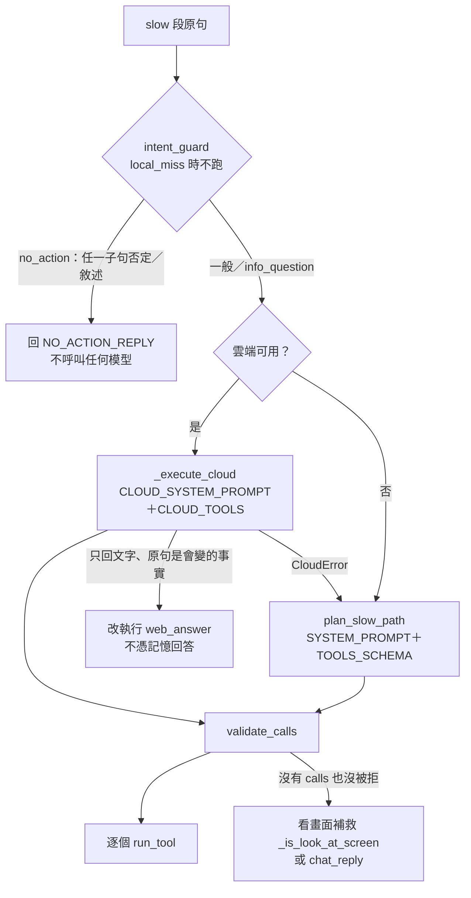

# Slow Path：LLM 規劃與驗證

Fast Path 沒命中的子句（slow 段），以及找檔案 0 筆後的轉交（`local_miss`），都由 `slow_path.execute_slow_path_llm` 處理。相關決策：[0007 G1](../decisions/0007-no-model-for-negation.md)、[0009 雲端](../decisions/0009-cloud-optional.md)、[0011 雲端工具](../decisions/0011-cloud-tools-and-site-open.md)、[0021](../decisions/0021-weather-answer.md)（`answer_mode`）、[0022 長尾回答](../decisions/0022-web-answer.md)、[0023 查詢路由](../decisions/0023-query-routing.md)（轉交走雲端、不憑記憶回答）、[0024](../decisions/0024-home-city-and-answer-timeout.md)（只聊天的一步）。

## D. execute_slow_path_llm

- **`intent_guard`**（`local_miss` 時不跑）
  - `no_action`（任一子句是否定／敘述）→ 回 `NO_ACTION_REPLY`，本機與雲端都不呼叫。
  - `info_question`（每個子句都是資訊提問）→ 照常規劃，但執行前丟掉 `STATE_TOOLS`。
- `targets`＝memory 裡最近成功的對象 ∪ 本句前面步驟的對象（給「它」的對象守門用）。
- **雲端**（`cloud_client.available()`）→ `_execute_cloud`
  - `local_miss`（找我的 X 本機 0 筆）時：user 訊息附本機搜尋結果，網頁搜尋用原話、不導回本機；模型沒有選任何動作 → `local_miss_reply`。
  - user 訊息＝`build_user_message`（原句＋名稱對照＋目前視窗）＋最近對話（`web` 時最後再加「## 今天日期」，台北時間）→ `cloud_client.chat(CLOUD_SYSTEM_PROMPT, cloud_tools(web))`；`web`＝`search_client.available()`（有 `BRAVE_API_KEY`），沒有時工具清單就是 `CLOUD_TOOLS`。
  - → `split_chat_texts`（把 `chat_reply(text)` 抽成文字）→ `validate_calls(cloud_schemas(web))`。
  - CloudError → `step["route"]="local"`、`cloud_fallback`，往下走本機。
  - 執行通過的 calls；沒工具也沒文字 → 看畫面補救或 `chat_reply`（本機 LLM 的 chat call）。
  - **不憑記憶回答**：沒有工具、沒有被拒絕、只回文字，而 `query_intent.verify_query(原句)` 成立 → 不採用那段文字，改執行 `web_answer`（查詢字用原話），記 `[Route 導向] 不憑記憶回答`；沒有搜尋金鑰時照 0023 第 4 條開搜尋頁。
  - 文字回覆只在沒有被拒絕、丟棄、失敗時採用；`read_screen`、`web_answer` 的結果本身就是回覆（同時有 content 時不採用）。
- **本機** → `plan_slow_path`：`_llm(SYSTEM_PROMPT＋build_user_message(含本機搜尋結果), PLAN_TIMEOUT_S, max_tokens 192)` → `validate_calls`
  - `info_question` 丟掉 `STATE_TOOLS`；`local_miss` 而且沒有 calls → 「找不到」。
  - 沒 calls 也沒被拒 → 看畫面補救（`_is_look_at_screen`）或 `chat_reply`；規劃呼叫的 content 不採用。
  - 有 calls → 逐個 `run_tool`。

**只聊天的一步** `execute_chat_only`（pipeline 的 escalate kind＝chat，目前只有「我住 X」，[0024](../decisions/0024-home-city-and-answer-timeout.md)）：不跑 `intent_guard`（Fast Path 已經命中），原句照原樣送出。

- 有雲端 → `plan_cloud(note=…)`：user 訊息最後附 `<note>`，system prompt 與工具不變。模型提出的工具呼叫與被拒絕的一律不執行（記在 `step["chat_dropped"]`），只採用文字；沒有文字回固定句。
- 沒有雲端、熔斷、CloudError → 本機 `chat_reply(fallback=固定句)`，`chat_hint`＝note，不帶工具。

## validate_calls（本機、雲端共用，依序）

1. 格式／JSON
2. `validate_tool_call(schemas)`：唯一的信任邊界（未知工具或參數、缺必填、型別錯、enum 不符一律拒絕；App 必須在詞庫或已安裝清單；專案只從白名單解析）
3. `target_error`：句子有代名詞時，對象必須可以追溯
4. 有 `web_answer`（雲端且有搜尋金鑰）時，依原句的 `answer_mode` 改寫：`web_answer` 但原句要看畫面 → `web_search_or_open_url`；`web_search_or_open_url`／`site_search` 但原句是在問事情 → `web_answer`（query 沿用）；之後的守門用改寫後的工具
   `web_search_or_open_url`：`_search_intent_error`；被拒時，`site_open_home` 可以放寬成網站首頁
5. `front_action`：句子說關閉時不得是 `minimize`
6. `site_search`：`_search_intent_error`
7. `local_miss` 時，query 換成原話
8. 沒有 `local_miss` 的搜尋：`_local_reroute`（本機優先導向）
9. `CLOUD_TOOL_TARGETS`（`site_search` → `context_search`）
